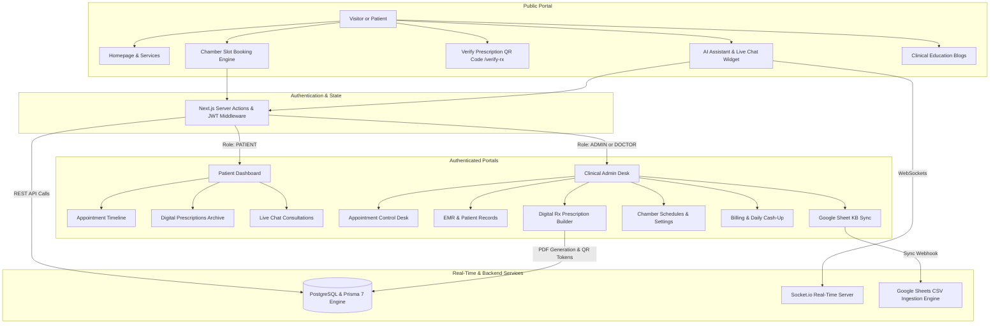

# CarePractice - Modern Doctor Chamber & Healthcare Management Platform (Client)

## Live Deployment & Repository Links
- Live Demo Application: https://medical-app-ecru.vercel.app/
- Backend API Service: https://medical-server-8wom.onrender.com
- Frontend Repository: https://github.com/nabilsiddik/Medical-App
- Backend Repository: https://github.com/nabilsiddik/Medical-Server

---

## Project Overview
CarePractice is an enterprise-grade outpatient chamber management, appointment booking, and telemedicine frontend built with Next.js 16 (App Router), React 19, TypeScript, and Tailwind CSS. The application serves two distinct user classes: patients seeking clinical consultations, verifiable digital prescriptions, and instant AI guidance; and clinical administrators/physicians managing multi-chamber operations, live consultations, patient EHR records, and financial accounting.

Designed with clinical usability and data integrity as foundational pillars, CarePractice eliminates double-booking through deterministic slot reservation, allows instant QR verification of digital prescriptions, and features a real-time consultation desk connected directly to clinical staff and an intelligent Google Sheets-backed knowledge base.

---

## Key Features

### Patient Experience
- Chamber & Telemedicine Scheduling: Real-time selection across physical clinical chambers and virtual telehealth slots with date/time pickers and automatic capacity validation.
- Verifiable Digital Prescriptions: Instant access to issued prescriptions with embedded QR codes and a dedicated public verification route (/verify-rx) allowing pharmacies to validate authentic physician issuance.
- Synchronized AI Practice Assistant: Floating interactive consultation widget that answers practice hours, appointment procedures, fees, and general clinical inquiries using verified knowledge base records.
- Live Consultation Chat: Direct bidirectional WebSocket communication channel connecting patients with clinical support and physicians.
- Patient Portal: Centralized dashboard for tracking upcoming visits, past medical history, prescribed medication regimens, and profile management.
- Medical Blog & Patient Education: Curated health articles with category filtering, search functionality, and readable typography.

### Clinical & Administrative Portal
- Operational Overview: High-level analytics tracking daily appointments, patient intake volume, revenue metrics, and pending consults.
- Appointment Management Desk: Complete control to confirm, reschedule, complete, or cancel appointments across physical chambers.
- Electronic Medical Records (EMR): Searchable patient directory maintaining historical consultation records, diagnostics, and prescription logs.
- Digital Rx Generation Studio: Rapid medication prescription builder supporting structured dosage instructions, duration, clinical notes, and PDF export.
- Chamber & Schedule Configuration: Multi-location management for clinic branches, operating hours, slot intervals, and holiday overrides.
- Billing & Daily Cash-Up: Invoice generation, fee collection reconciliation, payment method tracking, and financial transaction histories.
- Google Sheets AI Knowledge Base Ingestion: One-click synchronization interface that maps Google Sheets columns directly into the backend AI assistant knowledge engine.
- Medical CMS Studio: Publication tools for drafting, editing, and publishing clinical health articles with rich text controls and SEO metadata.

---

## System Architecture & User Flow



---

## Technology Stack

| Category | Technology | Purpose |
|---|---|---|
| Framework | Next.js 16 (App Router) | Server-Side Rendering (SSR), Server Components, and optimized routing |
| Library | React 19 | UI component architecture and modern concurrent rendering features |
| Language | TypeScript 5 | End-to-end static typing and interface contracts |
| Styling | Tailwind CSS 4 | Utility-first styling with high performance and zero runtime overhead |
| UI Primitives | Radix UI / Shadcn UI | Accessible, headless modal, popover, dropdown, and alert dialog primitives |
| Real-Time | Socket.io Client | Bidirectional event-driven communication for live consultation chats |
| State & Forms | React Hook Form, Zod | Schema-driven client-side and server-side validation |
| Data Visualization | Recharts | Analytics dashboards for clinic revenue and appointment metrics |
| Icons | Lucide React | Clean, consistent clinical iconography |
| Animation | Motion | Smooth micro-interactions and modal transitions |
| Date Handling | date-fns | Accurate clinical calendar scheduling and slot calculations |

---

## Environment Variables

Create a `.env.local` file in the root of the frontend repository:

```env
# Backend REST API Base URL
NEXT_PUBLIC_API_URL=https://medical-server-8wom.onrender.com/api/v1

# Server URL for SSR and Internal Fetching
NEXT_PUBLIC_SERVER_URL=https://medical-server-8wom.onrender.com/api/v1

# Real-Time WebSocket Server Endpoint
NEXT_PUBLIC_SOCKET_SERVER_URL=https://medical-server-8wom.onrender.com

# Canonical Client URL
NEXT_PUBLIC_SITE_URL=https://medical-app-ecru.vercel.app

# Environment Mode
NODE_ENV=development
```

### Environment Variables Reference

| Variable | Required | Description |
|---|---|---|
| NEXT_PUBLIC_API_URL | Yes | Base URL for client-side API requests |
| NEXT_PUBLIC_SERVER_URL | Yes | Base URL used by server-side fetch utilities |
| NEXT_PUBLIC_SOCKET_SERVER_URL | Yes | Host URL for the Socket.io real-time chat connection |
| NEXT_PUBLIC_SITE_URL | Yes | Public application URL used for metadata, OpenGraph, and verification links |
| NODE_ENV | Yes | Application environment flag (development or production) |

---

## Installation & Local Development

### Prerequisites
- Node.js version 20.0.0 or higher
- npm (v10+) or pnpm / yarn
- Running instance of the CarePractice backend API

### Step-by-Step Setup

1. Clone the repository:
```bash
git clone https://github.com/nabilsiddik/Medical-App.git
cd Medical-App
```

2. Install dependencies:
```bash
npm install
```

3. Configure environment variables:
```bash
cp .env.local.example .env.local
```
Update `.env.local` with your backend server URL (e.g., `http://localhost:5000/api/v1` for local development).

4. Run the development server:
```bash
npm run dev
```

5. Open the application:
Visit `http://localhost:3000` in your browser.

### Production Build

To create an optimized production build:
```bash
npm run build
npm run start
```

---

## Folder Structure

```
DOCTOR_FRONTEND/
|-- app/
|   |-- (dashboardLayout)/
|   |   |-- admin/dashboard/         # Doctor & Clinical management desk
|   |   |   |-- appointments/        # Slot & booking management
|   |   |   |-- billing/             # Cash-up, invoices & transactions
|   |   |   |-- blogs/               # CMS article management
|   |   |   |-- chat/                # Real-time staff chat console
|   |   |   |-- google-sheet/        # AI knowledge base sync portal
|   |   |   |-- patients/            # EMR patient directory
|   |   |   |-- prescriptions/       # Digital prescription builder
|   |   |   |-- profile/             # Doctor credentials & chambers
|   |   |   |-- schedules/           # Weekly clinic hours & slot setup
|   |   |   |-- settings/            # Clinic branding & metadata
|   |   |   `-- users/               # System user management
|   |   `-- user/dashboard/          # Patient personal health portal
|   |       |-- appointments/        # Booking history & upcoming visits
|   |       |-- prescriptions/       # Issued medical prescriptions
|   |       |-- profile/             # Patient details
|   |       `-- security/            # Password & credentials
|   |-- (mainLayout)/
|   |   |-- blog/                    # Public healthcare articles
|   |   |-- book/                    # Dynamic multi-chamber booking flow
|   |   |-- contact/                 # Chamber inquiry & emergency hotline
|   |   |-- login/ & signup/         # Patient & staff authentication
|   |   |-- services/                # Clinical treatments & fee table
|   |   `-- verify-rx/               # Public QR code prescription verification
|   |-- layout.tsx                   # Root HTML shell & metadata
|   `-- globals.css                  # Global styles & Tailwind configuration
|-- components/
|   |-- chat/                        # Floating AI widget & live chat client
|   |-- medicate/                    # Header, Footer, Hero, Services components
|   |-- ui/                          # Radix UI / Shadcn accessible design system
|   `-- app-sidebar.tsx              # Role-aware dashboard navigation
|-- lib/
|   |-- authUtils.ts                 # JWT extraction & role validation
|   |-- printAppointmentSlip.ts      # Printable appointment slip generator
|   `-- serverFetch.ts               # SSR authenticated fetch wrapper
|-- services/                        # Modular API client functions
`-- public/                          # Static assets, branding logos & icons
```

---

## Engineering Highlights for Technical Reviewers

- High-Performance Hybrid Architecture: Leverages Next.js App Router for server-rendered landing pages (high SEO, low TTFB) alongside responsive client-side state for appointment booking and live chat.
- Tamper-Resistant Prescription Verification: Each prescription issued contains an encrypted hash identifier rendered as a high-density QR code. Anyone scanning the QR code is directed to `/verify-rx`, which validates the cryptographic signature directly with the database.
- Dynamic Multi-Chamber Scheduling Algorithm: Calculates real-time slot availability based on operating days, slot durations (e.g., 15/20/30 mins), existing active bookings, and physician breaks to prevent overlaps.
- Accessible Design System: Every dialog, popover, select, and dropdown conforms to WAI-ARIA standards through Radix UI headless primitives.
- Google Sheets AI Knowledge Base Ingestion: Clinical staff without technical knowledge can update practice information in a standard Google Sheet; the frontend triggers an automated webhook that re-indexes the knowledge base in seconds.

---

## Related Repositories
- Backend API Service: [CarePractice Medical Server](https://github.com/nabilsiddik/Medical-Server)

---

## Author
Developed by MD. Nabil Siddik.
